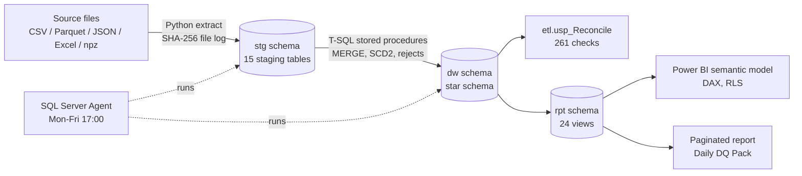

# Trading Data Warehouse & Power BI Reporting Layer

A production-style BI layer built on top of my own market-data pipeline (NSE index futures & options, collected daily
since April 2026). It is a **SQL Server star-schema warehouse** loaded by **Python + T-SQL stored procedures**, with
**reconciliation controls**, a **SQL Agent** nightly job, documented **query tuning**, and a **Power BI semantic model**
(DAX, row-level security) on top.

> Personal project. The source data and the upstream pipeline code are private and not included. The three business
> users in the requirements are role-played personas: a data owner, a desk head and a risk reviewer.

## Status

| Phase | What | Status |
|---|---|---|
| 1 | Requirements (personas, business questions, 24 KPIs), source profiling, pre-registered control totals | Done |
| 2 | Dimensional design and DDL: star schema, SCD2, data dictionary generated from the catalog | Done |
| 3 | Extract and staging: full and incremental loads, run / step logging | Done |
| 4 | Stored-procedure warehouse load, reconciliation, SQL Agent job | Done |
| 5 | SQL Server tuning with actual execution plans; analytic queries; `rpt` views (the Power BI contract) | Done |
| 6 | Power BI semantic model: Power Query, relationships, DAX measures validated against SQL, RLS, PBIP/TMDL | In progress (4 of 6 steps) |
| 7 | Report pages: overview, DQ control centre + drill-through, pipeline health, model evaluation, trades & costs | Planned |
| 8 | Paginated Daily DQ Pack (Report Builder) | Planned |


## Architecture



## Highlights

**Dimensional model (Kimball)**
- 10 dimensions and 9 facts with the grain of each fact fixed in one sentence (bus matrix in `docs/Phase1_Requirements.xlsx`).
- Surrogate keys, an *Unknown* (-1) member in every dimension, trusted foreign keys, and **SCD Type 2** on `DimDataset`
  (contract versions with ValidFrom / ValidTo / IsCurrent / RowHash).
- Role-playing dimensions (trade entry/exit date and time; actual vs predicted class).
- `FactFeatureValue`: 8,749,765 rows in a **clustered columnstore** index.
- Every column carries a description stored as an extended property; the data dictionary
  (`docs/Phase2_Data_Dictionary.xlsx`) is generated from the database catalog, so it cannot drift from the schema.

**ETL / ELT**
- `etl/extract.py`: one reader per source type, with lineage (source file, row number, SHA-256) on every staged row.
- `etl/load_stage.py --mode full | incremental`: incremental loads detect new or changed files by hash plus a watermark.
  Late-arriving re-checks replace the earlier rows, and the file log advances only after the load *and* the
  reconciliation pass.
- 21 load and control stored procedures (`sql/10`–`13`) using TRY/CATCH, explicit transactions, NULL-safe change
  detection (`EXISTS … EXCEPT`), and TRY_CONVERT with bad rows sent to `etl.RejectRow` as JSON. Delete-by-file
  plus insert makes every reload idempotent.
- SQL Server Agent job (Python step + T-SQL step) with failure handling. Every run is visible in
  `etl.RunLog` / `etl.StepLog`.

**Data quality and reconciliation**
- 149 control totals (row counts, rupee sums, model figures) were **pre-registered in git before the first load**
  (`docs/preregistered_targets.json`).
- `etl.usp_Reconcile` checks source → staging → warehouse plus the targets: **261 checks, 0 breaks** on a full load.
- The warehouse's "latest run wins" DQ verdict (window function) equals the production data-quality gate on all 141 dates.

**SQL Server performance tuning** (`docs/Phase5_SQL_Tuning.xlsx`, actual plans in `docs/plans/`)

| Experiment | Before | After |
|---|---|---|
| Missing index on a date filter | 11,092 logical reads | 14 |
| Non-SARGable predicate (function on column) | 958 reads | 5 (date-key seek) |
| Rowstore vs clustered columnstore, 8.7M rows | 262.8 MB, 33,925 reads | 71.8 MB, 7,785 reads |
| Columnstore segment elimination | filter on feature: 9 of 9 segments read | filter on date: 8 of 9 skipped |
| Parameter sniffing (skewed severity) | reused plan: 82,531 reads | 1,261 (RECOMPILE / OPTIMIZE FOR UNKNOWN measured) |

Six analytic queries (`sql/30_analytics.sql`) use CTEs and window functions: rolling 20-trading-day rate, LAG,
RANK, running P&L and drawdown, and gaps-and-islands. Each one is checked cell by cell against an independent pandas
calculation from the source files.

**Power BI semantic model** (`powerbi/TradingBI.pbip`, saved as TMDL text so every change is a readable git diff)
- One specification (`etl/semantic_model.py`) generates the TMDL model (`etl/build_pbip.py`, checked with
  Microsoft's TMDL serializer), the measure catalog and the validation cases.
- Power Query reads the 24 `rpt` views through `Server` / `Database` parameters, so Dev → Prod is one switch, and
  every query folds to SQL.
- 34 single-direction relationships, including role-playing trade entry/exit dates. The inactive ones are used
  through USERELATIONSHIP. Date is marked as the date table.
- 46 DAX measures in 5 display folders:
  - data-quality pass rate, a rolling 20-trading-day fail rate and days since the last unresolved FAIL;
  - model accuracy, balanced accuracy, macro F1, and precision / coverage at a what-if threshold;
  - net P&L with MTD and Indian fiscal-year YTD, cumulative P&L, drawdown and max drawdown.
- Row-level security: static desk roles plus a dynamic role driven by `USERPRINCIPALNAME()` and a user-to-desk table.
- **Every measure was validated against SQL:** 138 of 138 cases matched (`docs/Phase6_Measure_Validation.xlsx`).
  `etl/validate_measures.py` runs the DAX in the open model and recomputes each value in SQL at the same moment.

**Report pages** (phase 7, see Status). Each page answers one business question from the signed-off requirements.
The expected value of every card and table was computed from the warehouse *before* the page was built
(`docs/phase7_expected.json`).

| Page | Business question | Main visuals |
|---|---|---|
| Overview | Is the latest session's data fit to use, and is the pipeline healthy? | Day verdict and traffic-light KPI cards, pass-rate trend, datasets with findings |
| DQ Control Centre | Which datasets failed which checks, when, and is each a known cause or a real incident? | Dataset × date heatmap, drill-through to a Check Detail page, cross-source check bars, bookmarks |
| Pipeline Health | Did the last ETL load complete, on time, and reconcile? | ETL runs and steps, reconciliation results by layer |
| Model Evaluation | How good is the production model out of fold, and how does precision change with the threshold? | Confusion matrix, recall per class, what-if threshold, feature importance with a drift tooltip page |
| Trades & Costs | What would the signals have earned after costs, and how deep was the drawdown? | Equity curve, drawdown, per-scenario table, RLS by desk |

## Repository layout

| Folder | Contents |
|---|---|
| `sql/` | Numbered T-SQL scripts: server setup, schemas, tables, staging, procedures, reconciliation, analytics, `rpt` views, tuning, RLS seed |
| `etl/` | Python: extract, staging load, DDL runner + data-dictionary generator, profiling, tuning harness, Agent job, Power BI artifacts and DAX validator |
| `tests/` | pytest suite (67 tests): DDL, staging, warehouse procedures, reconciliation, tuning, semantic-model spec |
| `powerbi/` | Power BI Project: `TradingBI.pbip`, the semantic model as TMDL (`TradingBI.SemanticModel/`), the report definition (`TradingBI.Report/`), Tabular Editor scripts |
| `docs/` | Requirements, source profile, data dictionary, tuning log + `.sqlplan` files, measure catalog and validation results, pre-registered targets and page expectations |

## Running it

Requirements: SQL Server 2022+ Developer edition, ODBC Driver 18, Python 3.12 (pandas, pyarrow, openpyxl, pyodbc,
sqlalchemy, pytest), Power BI Desktop, DAX Studio, Tabular Editor 2.

The scripts expect this folder as `bi/` inside the pipeline repository, because they read its source files. Without
that data you can still read the code, build the empty schema, and open the plans and workbooks.

```bash
# 1. In SSMS: run sql/00_setup_server.sql (memory cap, TradingBI_Dev / TradingBI_Prod)
# 2. Copy config.example.ini to config.ini (Windows authentication, no passwords stored)
python etl/apply_ddl.py --rebuild          # Dev only: schema, staging, procedures, views, data dictionary
python etl/load_stage.py --mode full       # stage + EXEC etl.usp_Run_All (load + reconcile)
python etl/create_agent_job.py             # nightly SQL Agent job (incremental)
python etl/tuning.py                       # tuning experiments -> docs/Phase5_SQL_Tuning.xlsx
python -m pytest -c pytest.ini --rootdir . tests
```

## How it maps to credit-risk reporting

| Built here | Credit-risk equivalent |
|---|---|
| DQ contracts, checks and daily verdict | Daily data-quality attestation over risk feeds (BCBS 239) |
| Source → staging → warehouse reconciliation, control totals | Risk-to-finance reconciliation, source-to-mart controls |
| Late-arriving re-checks, "latest run wins" | Restated exposures, as-of vs as-was reporting |
| SCD2 dataset versions | Counterparty hierarchy and rating history |
| Desk-based RLS | Business-unit / legal-entity security |
| Daily DQ Pack (paginated) | Regulatory and committee packs |
| Model evaluation and drift | PD / LGD model monitoring |

## Author

Jitendra Hirani: credit-risk and regulatory-reporting professional (FRM).

Developed with AI pair-programming assistance (Claude). I reviewed and tested each step and can walk through every
design decision.
